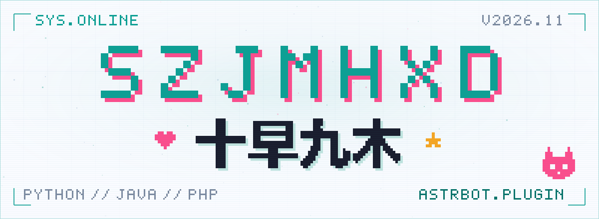
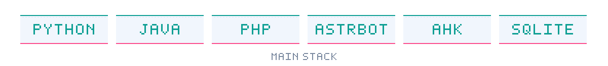
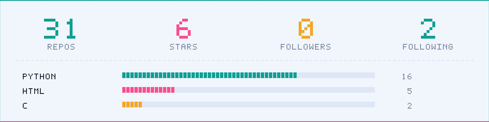

<!--
  ═══════════════════════════════════════════════════════════
  GitHub Profile README · 像素 × 科幻 × 二次元
  ═══════════════════════════════════════════════════════════
  部署步骤：
  1. 新建仓库，仓库名 = szjmhxd（必须与用户名完全一致、必须 public）
  2. 把 README.md 和 assets/ 目录一起提交到仓库根目录

  所有视觉素材都是仓库内的 SVG，不依赖第三方图床。
  浅色 / 深色各一套，由 <picture> 按系统主题自动切换。

  重新生成视觉资源：
    浅色  python tools/gen_banner.py
    深色  THEME=dark python tools/gen_banner.py
  ═══════════════════════════════════════════════════════════
-->

  <picture>
    <source media="(prefers-color-scheme: dark)" srcset="./assets/banner-dark.svg" />
    
  </picture>

邮箱 <code>zlzzz122@163.com</code>

<picture>
  <source media="(prefers-color-scheme: dark)" srcset="./assets/divider-now-dark.svg" />
  
</picture>

- **AstrBot 插件**：`lolmatch` 赛事推送、`bili_card` 链接卡片、`steamhub` Steam 好友动态，三个在同步维护
- **自用小工具**：`nas-log-analyzer` 群晖审计日志检索、`symlink-explorer` Windows 软链接管理
- **AHK 脚本**：`ahk-scripts` 随手加，最近补了小米妙享的右键返回与中键回桌面
- **博客**：[szjmhxd.github.io](https://szjmhxd.github.io) 不定期记点实现细节

最后更新 2026.11

<picture>
  <source media="(prefers-color-scheme: dark)" srcset="./assets/divider-stack-dark.svg" />
  
</picture>

  <picture>
    <source media="(prefers-color-scheme: dark)" srcset="./assets/skills-dark.svg" />
    
  </picture>

<picture>
  <source media="(prefers-color-scheme: dark)" srcset="./assets/divider-stats-dark.svg" />
  
</picture>

<picture>
  <source media="(prefers-color-scheme: dark)" srcset="./assets/stats-dark.svg" />
  
</picture>

<picture>
  <source media="(prefers-color-scheme: dark)" srcset="./assets/divider-work-dark.svg" />
  
</picture>

### 精选项目

| 项目 | 说明 | 栈 |
| --- | --- | --- |
| [astrbot_plugin_lolmatch](https://github.com/szjmhxd/astrbot_plugin_lolmatch) | 英雄联盟职业赛事查询与定时推送：赛程、赛果、逐局数据，支持 @ 提醒与可提醒时段 | Python |
| [astrbot_plugin_bili_card](https://github.com/szjmhxd/astrbot_plugin_bili_card) | 识别 B 站视频 / 番剧 / 直播 / 专栏 / 动态 / 音频等各类链接，渲染成图文卡片并附可复制链接 | Python |
| [astrbot_plugin_steamhub](https://github.com/szjmhxd/astrbot_plugin_steamhub) | 通过 Steam Web API 导入好友名单，按序号绑定群成员，推送上下线与开玩提醒 | Python |
| [nas-log-analyzer](https://github.com/szjmhxd/nas-log-analyzer) | 群晖 NAS 审计日志的本地可视化检索：自动清洗去重、按文件追踪操作轨迹、SQLite 查询，纯标准库零依赖 | Python |
| [symlink-explorer](https://github.com/szjmhxd/symlink-explorer) | Windows 软链接管理器：全盘扫描 reparse point、工作区卷校验、分类显隐，纯标准库 | Python |
| [ahk-scripts](https://github.com/szjmhxd/ahk-scripts) | AutoHotkey v2 自用脚本合集，MathInput 可在任意输入框敲算式按 = 直接出答案，支持链式计算 | AHK |
